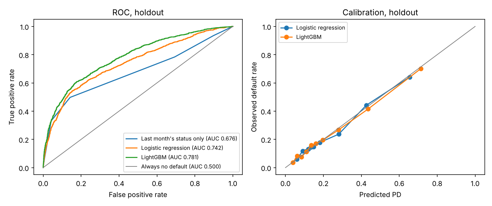
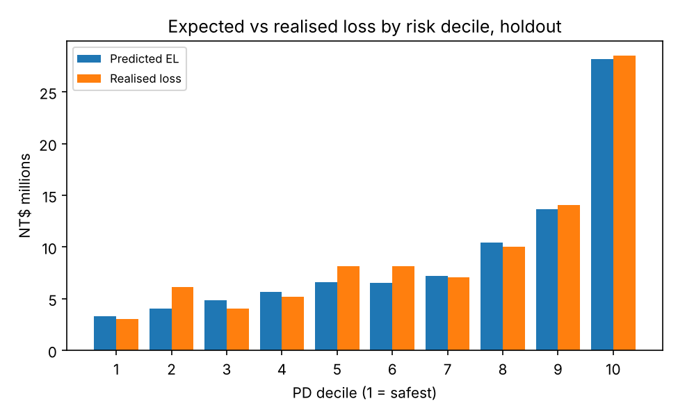

# Credit Card Default: Honest Baselines and Expected Loss

Predicts which credit card holders will default next month, then turns those probabilities into the
number a lender actually budgets for: **expected loss = PD x LGD x EAD**.

Data: the UCI "Default of Credit Card Clients" dataset, 30,000 card holders in Taiwan (2005), with
six months of balances, payments and repayment status. 22.1% of them defaulted.

## Why this version exists

The first version of this project reported 81% accuracy and a 0.70 ROC-AUC. On this dataset,
predicting "no default" for everyone is already 77.9% accurate, so accuracy says almost nothing.
This version starts from baselines and judges every model against them.

## Results (stratified 20% holdout, 6,000 accounts)

| Model | Accuracy | ROC-AUC | PR-AUC | Brier |
|---|---|---|---|---|
| Always predict "no default" | 77.9% | 0.500 | 0.221 | 0.221 |
| Last month's repayment status only | 81.9% | 0.676 | 0.433 | 0.149 |
| Logistic regression, all features | 80.6% | 0.742 | 0.502 | 0.143 |
| **Gradient boosting (LightGBM)** | **81.9%** | **0.781** | **0.561** | **0.135** |

5-fold cross-validated AUC on the training set: logistic 0.757 (sd 0.007), LightGBM 0.787 (sd 0.005).

What the table shows:
- **Accuracy is the wrong metric here.** A one-variable rule ties the best model on accuracy and
  beats logistic regression. Ranking metrics (AUC, PR-AUC) and calibration (Brier) separate them.
- **Gradient boosting adds real signal** over logistic regression: +0.039 AUC on the holdout and
  +0.030 in cross-validation, several times the fold-to-fold variation.
- **Both models are well calibrated** (see the calibration plot), which matters more than accuracy
  once probabilities become money.

## Expected loss

For each account: **EL = PD x LGD x EAD**
- **PD**: the LightGBM default probability.
- **EAD** (exposure at default) = current balance + 50% of the unused limit, because borrowers
  heading for default tend to draw down their line first.
- **LGD** (loss given default) = 75%, a typical figure for unsecured card debt.

The dataset contains neither LGD nor recoveries. Both are stated assumptions at the top of the
script and easy to change; the sensitivity table below shows how much they matter.

| | NT$ |
|---|---|
| Holdout exposure at default | 661.9M |
| Predicted expected loss (LightGBM) | 90.5M (13.7% of EAD) |
| Realised loss on the holdout (actual defaults x same LGD and EAD) | 94.3M |
| Predicted / realised | 0.96 (logistic: 0.95; one flat PD for everyone: 1.16) |

- **Risk is concentrated:** the riskiest 10% of accounts default 70% of the time, against 3.7% for
  the safest 10%. The riskiest 20% of accounts generate 45% of the realised loss.
- **LGD dominates the dollar figure:** expected loss ranges from NT$54.3M at 45% LGD to
  NT$108.6M at 90%. PD models get most of the attention, but the recovery assumption moves the
  answer by a factor of two.




## Run it

```
pip install -r requirements.txt
python src/credit_el.py
```

Writes `results/metrics.json`, `results/el_by_decile.csv` and two figures in under a minute.

## Modelling choices

- **SEX and MARRIAGE are excluded.** US fair lending law (ECOA) bars them from credit decisions,
  so a model meant to resemble a real scorecard should not use them.
- Engineered features: utilisation (balance / limit), number of late months in the last six, worst
  repayment status, and the share of billed amounts actually paid.
- Logistic regression keeps the original pipeline: median imputation and standardisation for
  numeric features, one-hot encoding for education.

## Limitations

- "Realised loss" uses the same LGD and EAD assumptions as the prediction, so the EL check tests
  the PD model, not the LGD assumption.
- One month of outcomes from 2005 Taiwan; a production model would be validated on a later period.
